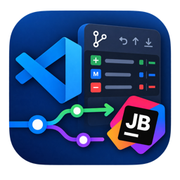

<a name="readme-top"></a>

<div align="center">



<h1>JetBrains Git</h1>

<strong>Git tools inspired by JetBrains IDE's</strong>

[](./LICENSE)
[](https://code.visualstudio.com/)
[](https://github.com/cscolley/jetbrains-git/releases)

[Changelog](https://github.com/cscolley/jetbrains-git/blob/main/CHANGELOG.md)

> A fork of [witt-bit/jetbrains-version-control](https://github.com/witt-bit/jetbrains-version-control) — providing JetBrains inspired git tools for VS Code

</div>

---

## Highlights

- **Git Log graph** — branch tree with Local / Remote / Tags, colour-coded lanes, resizable columns and commit filters
- **IDEA-style commit panel** — stage by checkbox, shelf and stash, per-block commit, AI-generated messages
- **Annotate with Git Blame** — inline annotations on every line, plus a caret line-end blame that follows the cursor
- **Full context menus** — branch, tag, HEAD, commit, changed file and remote, all modelled on IntelliJ IDEA
- **3-way merge editor** and a conflict list, instead of VS Code's block-by-block conflict UI
- **Git Worktree panel**, Explorer status colours and gutter change markers — so the built-in Git extension can be switched off entirely

### Added in this fork

Everything below was added after forking from [witt-bit/jetbrains-version-control](https://github.com/witt-bit/jetbrains-version-control):

- **Changelists** — group unstaged changes into named lists, like IDEA's Changes view
- **Interactive rebase** dialog, plus Edit Commit Message, Fixup and Squash Into
- **Smart checkout** — no more failures on a dirty working tree
- **Rejected pushes recover in place**, with protected branches and force-with-lease
- **Update method** (merge / rebase), stash options, fetch options and background auto-fetch
- **Commit checks**, sign-off, Git hooks switch and GPG signing
- **Git Log message / path filters** and Go To Hash / Branch / Tag
- **Repository commands** — clone, init, submodules, sparse checkout, unshallow / deepen
- **Shelf toolbar**, cherry-pick options and blame options

## Features

### Git Log


- **Branch tree** — Local / Remote / Tags groups, directory grouping, search filter, `HEAD (Current Branch)` row
- **Commit list** — colour-coded branch lanes, resizable Message / Author / Date / Hash columns, collapsible commit sequences
- **Detail panel** — commit message plus a changed-file tree
- **Filters** — by branch, author and date range
- **Multi-selection** — Shift+click ranges, Cmd/Ctrl+click to toggle, Shift+Arrow from the keyboard
- **Message filter** — Match Case and Regex toggles; Git applies it across the whole history, and it stays in force while scrolling and refreshing
- **Path filter** — show only commits touching a file or folder
- **Go To Hash / Branch / Tag** — `Cmd+Shift+L` (`Ctrl+Shift+L`) finds a commit, loading more history until it appears and lifting any filter that hides it; `Ctrl+L` focuses the filter box
- **Dim cherry-picked commits** — a toolbar toggle dims commits already cherry-picked onto HEAD
- **Interactive rebase** — see [below](#interactive-rebase)

### Commit Panel

Working-tree changes with a JetBrains layout.

- **Only checked files are committed** — a staged but unchecked file is unstaged for the commit and restored afterwards
- **Shelf and stash** — shelve, unshelve, view a shelf diff and import patches, alongside IDEA-format shelves
- **Jump to Source** — `F4`, or `Cmd+↓` / `Ctrl+↓`, from the file list, the Git Log changed files and inside a diff editor
- **AI commit message** — see below
- **Changelists** — see [below](#changelists)
- **Commit options and checks** — see [below](#commit-options-and-checks)
- **Group by directory**, show or hide unversioned files, and a pending-changes badge on the activity bar icon

### Changelists

Group unstaged changes into named lists in the Commit panel, like IDEA's Changes view. It is an overlay on the index, not a replacement: the Staged group, Unversioned Files and Merge Conflicts behave exactly as before.

- **Create, rename, delete and Set Active** from a list's right-click menu or the New Changelist toolbar button; new changes land in the active list
- **Drag and drop** files, or a whole selection, onto a list — or use **Move to Another Changelist...** from a file or folder menu
- **Shelve Changelist...** shelves just that list's files
- **Partial commits** — after committing only some of a list, an offer moves the files you left behind into a new list
- **Changes view** — gets a Changelist grouping too
- **Stored per worktree** inside the git directory, never in the repository
- **Switch off** with `jgc.changelists.enabled`

### Commit Options and Checks

- **Gear menu** in the Commit panel with **Sign-off** and **Run Git hooks** switches
- **Pre-commit warnings** — large files, CRLF line endings, a detached HEAD or rebase in progress, and a missing `user.name` / `user.email`, each with a "Commit anyway" prompt; every check can be turned off (`jgc.commit.*`)
- **GPG signing** — **Choose GPG Key...** picks a key and turns signing on; `jgc.commit.gpgSign` (`auto`, `always`, `never`) forces or disables it per commit

### Shelf and Stash

- **Shelf toolbar** like the JetBrains Shelf window — Unshelve, Restore (keeps the shelf), Create Patch, Copy as Patch to Clipboard, Delete, Import Patches and Import Patches from Clipboard; the actions are disabled until a shelf is selected
- **Stash options** from the Stash tab toolbar — Stash Changes... (keep index, include untracked), Unstash As... (as a new branch, pop, reinstate index) and Clear All Stashes...

### Update, Checkout, Push and Fetch

- **Update method** — `jgc.update.method` (`merge`, `rebase` or `branchDefault`) decides how Update Project, Pull and branch updates integrate upstream changes; `jgc.update.saveChangesPolicy` (`stash` or `shelve`) decides how local changes are carried across
- **Smart checkout** — checking out a branch, tag or commit, or creating a branch, on a dirty working tree prompts for **Smart** (stash, switch, restore), **Force** (discard, after a second confirmation) or **Cancel**; untracked files that would be overwritten are explained instead of offering a destructive option
- **Rejected pushes recover in place** — from the branch menu, Commit and Push and Push All up to Here, a rejected push offers Merge, Rebase or Force with lease, then retries once; the Push panel adds Force with lease and "Remember my choice", and a first push sets the upstream
- **Protected branches** — `jgc.protectedBranches` (default `main`, `master`; `*` globs allowed) refuses force pushes, asks for explicit confirmation before deleting, and keeps them out of Clean Up Merged Branches
- **Fetch options** — prune, tags mode and background auto-fetch (`jgc.fetch.*`)
- **Cherry-pick options** — empty commits can be asked about, skipped or created (`jgc.cherryPick.emptyStrategy`), and `-x` can be appended (`jgc.cherryPick.appendSourceHash`)

### Interactive Rebase

**Interactively Rebase from Here...** on any commit opens a dialog with per-commit pick / reword / edit / squash / fixup / drop, reordering, `--onto`, autosquash, keep-empty, update-refs and rebase-merges. Continuing a rebase no longer opens an editor.

### Repository Commands

- **Clone Repository** — with progress and cancel; never prompts for credentials (`jgc.clone.recurseSubmodules` controls submodule cloning)
- **Create Git Repository** for a workspace that is not one yet
- **Submodules** — list, update, sync and open
- **Sparse checkout** — status, enable, set, add and disable
- **Unshallow / Deepen** a shallow clone

### AI Commit Message

A sparkle button next to **Commit** writes the message for exactly the files you checked, streaming into the input box so you can edit before committing.

- Runs on the VS Code Language Model API (`vscode.lm`): GitHub Copilot out of the box, plus models added under **Chat: Manage Language Models** (OpenRouter, Ollama, OpenAI-compatible endpoints) or contributed by other extensions — JGC itself has no configuration
- Only the checked files: staged entries diff against the index, unstaged against the worktree, untracked files contribute their content
- Style reference: the committer's own recent commits first, falling back to the repository's latest history; the message follows the reference's language
- Several models installed: asked once and remembered, the chevron beside the sparkle reopens the picker, and clicking again cancels a running generation
- A failure or a cancel restores whatever you had already typed

### Annotate with Git Blame

WebStorm-style inline blame on every line, with click-to-jump into the Git Log commit graph.

- **Every line annotated** — configurable columns: revision, date, author, commit number
- **Name styles** — initials, last name, first name, full name or email
- **Age-based colouring** — new → blue, mid → green, old → grey, or colour by author, or no colour at all
- **Each diff column is independent** — toggling blame on one side leaves the other side alone
- **Configurable** — `jgc.blame.columns`, `jgc.blame.colorMode`, `jgc.blame.nameStyle`, `jgc.blame.dateFormat`
- **Attribution options** — `jgc.blame.ignoreWhitespace` and `jgc.blame.detectMovements` (`none`, `inner`, `outer`) control how lines are attributed

### Caret Line-End Blame

`Who, date * summary` at the end of the line the caret is on, following the cursor instead of annotating every line.

- **Own commits read `You`**; uncommitted lines show nothing
- **Template** — `jgc.caretBlame.format` with `${who}`, `${date}`, `${message}` and `${hash}` tokens
- **Date format** — `${date}` renders through `jgc.blame.dateFormat`, the same setting as the inline annotations
- **Caps** — summary at 50 characters, hash at 8, cut with an ellipsis
- **Toggle** — `jgc.caretBlame.enabled`

### Explorer Colours and Gutter Markers

- **File colours** — Explorer file names are tinted by added, modified, deleted, untracked, ignored and conflict status
- **Gutter markers** — a coloured bar beside every added or modified line, a short marker where lines were deleted
- **Change hover card** — hovering a marker or a changed line shows that block: modified lines are word-diffed, a deleted block shows its HEAD content, with Prev Change / Next Change / Rollback Lines / Show Diff for Lines / Copy / Commit this change
- **Switched off independently** — `jgc.decorations.enabled`, `jgc.decorations.fileColors`, `jgc.decorations.gutterMarkers`

### 3-Way Merge Editor


- Three-column layout: Theirs | Result | Yours
- Conflict highlighting with per-block action buttons
- Full syntax highlighting

### Conflict Management


- Quick actions: accept theirs, accept yours, merge
- Integrated with the VS Code Source Control panel

### Git Worktree

JetBrains-style worktree management in the activity bar sidebar.

- **Worktree list** — every worktree with its branch and path, the main worktree protected from deletion
- **Lock / Unlock** — a locked worktree shows a lock and cannot be deleted
- **New Worktree** — searchable dropdown for local branches, `origin/*` and tags, with input validation, auto-filled project name and a live duplicate-name check
- **Open project** — native VS Code dialog: this window or a new one
- **Prune** — clean up stale worktree metadata
- **Behaviour** — `jgc.worktree.openBehavior`: `ask` (default), `thisWindow` or `newWindow`

### Status Bar

- Current branch with incoming and outgoing commit counts, replacing the built-in Git item
- Click for Update Project, Commit, Push, New Branch, Switch Branch and the Git Log view
- Follows the active editor in multi-root workspaces; a detached HEAD is shown rather than disappearing

### Remote Management

- **Manage Remotes...** on the Remote section header of the sidebar — list, add, rename, re-address and remove remotes, with an optional fetch right after
- **Edit Remote / Remove Remote** on any remote's folder row, with a confirmation before removing
- **Built-in Git prompt** — a first-run offer to disable VS Code's built-in Git so two Git UIs do not duplicate the status bar and decorations; it applies to the current workspace and can be switched back

---

## Context Menus

<details>
<summary><b>Branch (right-click)</b></summary>

- Checkout
- New Branch from 'branch'...
- Checkout and Rebase onto 'current'
- Rebase 'current' onto 'branch'
- Merge 'branch' into 'current'
- Rename...
- Delete (with force-delete fallback; protected branches ask for confirmation)
- Set Upstream / Unset Upstream
- Clean Up Merged Branches...
- Update
- Push...

</details>

<details>
<summary><b>HEAD row (right-click)</b></summary>

- New Branch from 'branch'...
- Show Diff with Working Tree
- New Worktree from 'branch'...
- Update
- Push...
- Rename...

</details>

<details>
<summary><b>Tag (right-click)</b></summary>

- Checkout
- Show Diff with Working Tree
- Merge 'tag' into 'branch'
- New Worktree from 'tag'...
- Push to remote...
- Delete (a multi-selection shows Delete only)

</details>

<details>
<summary><b>Commit (right-click)</b></summary>

- Copy Revision Number
- Cherry-Pick
- Create Patch...
- Checkout Revision
- Interactively Rebase from Here...
- Edit Commit Message
- Fixup / Squash Into
- Show Repository at Revision
- Compare with Local
- Reset Current Branch to Here... (Soft / Mixed / Hard / Keep)
- Revert Commit
- Undo Commit... (HEAD only, not on main or master)
- Drop Commit
- Push All up to Here...
- New Branch...
- New Tag...
- Go to Child Commit / Go to Parent Commit
- Show in Git Log (when the Commit list is filtered by a file)

</details>

<details>
<summary><b>Changed file (right-click)</b></summary>

- Show Diff
- Edit Source (with its shortcut)
- Open Repository Version
- Revert Selected Changes
- Cherry-Pick Selected Changes
- Copy Path
- Copy File Name
- History Up to Here

</details>

<details>
<summary><b>Remote (right-click)</b></summary>

- On a remote's folder: Edit Remote, Remove Remote
- On the Remote section header: Manage Remotes...

</details>

---

## Configuration

Search for `JGC` in VS Code Settings.

| Setting | Description | Default |
|---------|-------------|---------|
| `jgc.decorations.enabled` | Explorer colours and gutter markers | `true` |
| `jgc.decorations.fileColors` | Explorer file colours | `true` |
| `jgc.decorations.gutterMarkers` | Gutter change markers | `true` |
| `jgc.blame.columns` | Annotated columns | `["date", "author"]` |
| `jgc.blame.colorMode` | Colouring mode | `order` |
| `jgc.blame.nameStyle` | Name display style | `fullName` |
| `jgc.blame.dateFormat` | Date format | `yyyy-MM-dd HH:mm` |
| `jgc.blame.foregroundColorLight` | Annotation colour, light themes | `#57606a` |
| `jgc.blame.foregroundColorDark` | Annotation colour, dark themes | `#8b949e` |
| `jgc.caretBlame.enabled` | Caret line-end blame | `true` |
| `jgc.caretBlame.format` | Caret blame template | `${who}, ${date} * ${message}` |
| `jgc.caretBlame.messageMaxLength` | Maximum characters of the summary | `50` |
| `jgc.blame.ignoreWhitespace` | Ignore whitespace changes when attributing lines | `true` |
| `jgc.blame.detectMovements` | How blame follows moved lines (`none`, `inner`, `outer`) | `inner` |
| `jgc.update.method` | How Update integrates upstream (`merge`, `rebase`, `branchDefault`) | `branchDefault` |
| `jgc.update.saveChangesPolicy` | Park local changes during update / checkout (`stash`, `shelve`) | `stash` |
| `jgc.push.autoSetUpstream` | Set the upstream on a branch's first push | `true` |
| `jgc.push.rejectedAction` | What to do when a push is rejected | `ask` |
| `jgc.protectedBranches` | Branches that refuse force pushes and confirm deletion (`*` globs) | `["main", "master"]` |
| `jgc.commit.signOff` | Add `Signed-off-by` to every commit | `false` |
| `jgc.commit.runHooks` | Run Git hooks when committing | `true` |
| `jgc.commit.gpgSign` | GPG-sign commits (`auto`, `always`, `never`) | `auto` |
| `jgc.commit.warnLargeFiles` | Confirm before committing large files | `true` |
| `jgc.commit.largeFileThresholdMB` | Size above which a file counts as large | `10` |
| `jgc.commit.warnCrlf` | Confirm before committing CRLF line endings | `true` |
| `jgc.commit.warnDetachedHead` | Confirm when HEAD is detached or a rebase is in progress | `true` |
| `jgc.commit.warnMissingIdentity` | Confirm when `user.name` / `user.email` is not set | `true` |
| `jgc.changelists.enabled` | Group changes into changelists | `true` |
| `jgc.changelists.offerMoveOnPartialCommit` | Offer to move leftover files after a partial commit | `true` |
| `jgc.fetch.prune` | Prune stale remote-tracking branches on fetch | `false` |
| `jgc.fetch.tagsMode` | Which tags a fetch brings along | `default` |
| `jgc.fetch.autoFetch` | Fetch all remotes in the background | `false` |
| `jgc.fetch.autoFetchIntervalMinutes` | Minutes between background fetches | `15` |
| `jgc.cherryPick.emptyStrategy` | Handling of commits that become empty (`ask`, `skip`, `createEmpty`) | `ask` |
| `jgc.cherryPick.appendSourceHash` | Append the source hash (`-x`) to cherry-picked commits | `false` |
| `jgc.clone.recurseSubmodules` | Clone submodules with Clone Repository | `false` |
| `jgc.worktree.openBehavior` | How projects open from a worktree | `ask` |
| `jgc.onboarding.builtinGitPrompt` | Offer to disable the built-in Git extension | `ask` |

The six status colours are also exposed as `jgc.decoration.*` colour IDs, so they can be overridden under `workbench.colorCustomizations`.

---

## Installation

**From the Marketplace** — search for **JetBrains Git**.

**From a .vsix**

1. Download the latest `.vsix` from [releases](https://github.com/cscolley/jetbrains-git/releases)
2. `Cmd+Shift+P` → "Extensions: Install from VSIX..."

## Requirements

- VS Code 1.91.0 or newer (the Language Model API became stable in 1.91)
- Git installed and on `PATH`

## Local Development

```bash
git clone https://github.com/cscolley/jetbrains-git.git
cd jetbrains-git
pnpm install
cd webview && pnpm install && cd ..
```

Press **F5** to launch the Extension Development Host.

```bash
pnpm run watch          # Watch mode
pnpm run build          # Production build (extension + webview)
pnpm run compile        # Type-check, verify, lint and bundle the extension
pnpm run test:unit      # Unit tests
pnpm run vsce:package   # Package as .vsix
```

See [AGENTS.md](./AGENTS.md) for the architecture and the conventions this codebase follows.

## Credits

- Forked from: [witt-bit/jetbrains-version-control](https://github.com/witt-bit/jetbrains-version-control)
- Icons: [IntelliJ IDEA Icons](https://intellij-icons.jetbrains.design/) (Apache 2.0)

## License

[MIT](./LICENSE)
