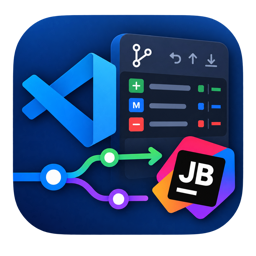

<a name="readme-top"></a>

<div align="center">



<h1>JetBrains Git</h1>

<strong>在 VS Code 与 Cursor 中使用 IntelliJ IDEA / JetBrains 风格的 Git</strong>

[](./LICENSE)
[](https://code.visualstudio.com/)
[](https://github.com/witt-bit/jetbrains-version-control/releases)

[English](https://github.com/witt-bit/jetbrains-version-control/blob/main/README.md) · **简体中文** · [更新日志](https://github.com/witt-bit/jetbrains-version-control/blob/main/CHANGELOG.zh_CN.md)

> 本项目 fork 自 [aotemj/jetbrains-git-graph](https://github.com/aotemj/jetbrains-git-graph)（该项目又 fork 自 [zhyc9de/jet-git](https://github.com/zhyc9de/jet-git)），并在此基础上增加了行内 Git Blame 注解、提交图导航、Shelf/Stash 提交面板与完整的 IDEA 风格右键菜单。

</div>

---

## 亮点

- **Git Log 提交图** — 本地 / 远程 / 标签分支树，彩色泳道，可调列宽，支持按分支、作者、日期过滤
- **IDEA 风格提交面板** — 按勾选提交、Shelf 与 Stash、单块提交、AI 生成提交信息
- **Annotate with Git Blame** — 全行行内注解，另有跟随光标的行尾 blame
- **完整右键菜单** — 分支、标签、HEAD、提交、变更文件、remote，均按 IntelliJ IDEA 的布局
- **三路合并编辑器**与冲突列表，替代 VS Code 逐块处理的冲突界面
- **Git Worktree 面板**、资源管理器状态着色与行号槽变更标记 —— 因此可以完全关闭内置 Git 扩展

## 功能特性

### Git 提交图


- **分支树** — 本地 / 远程 / 标签分组，支持目录分组、搜索过滤，以及 `HEAD (Current Branch)` 行
- **提交列表** — 彩色分支泳道，Message / Author / Date / Hash 列宽可调，提交序列可折叠
- **详情面板** — 提交信息与变更文件树
- **过滤器** — 按分支、作者、日期范围
- **多选** — Shift+点击范围选择、Cmd/Ctrl+点击逐个切换、Shift+方向键键盘选择

### 提交面板

JetBrains 布局的工作区变更列表。

- **只提交勾选的文件** — 已暂存但未勾选的文件会在提交前移出暂存区，提交后恢复
- **Shelf 与 Stash** — 搁置、恢复、查看 Shelf 差异并导入补丁，同时兼容 IDEA 格式的 Shelf
- **Jump to Source** — `F4`，或 `Cmd+↓` / `Ctrl+↓`，在文件列表、Git Log 的变更文件与 diff 编辑器内均可用
- **AI 生成提交信息** — 见下
- **按目录分组**、显示或隐藏未跟踪文件，活动栏图标上显示待提交数量角标

### AI 生成提交信息

Commit 按钮旁的 ✨ 只为已勾选的文件生成提交信息，结果流式写入输入框，提交前可编辑。

- 基于 VS Code 语言模型 API（`vscode.lm`）：GitHub Copilot 开箱即用，也可使用 **Chat: Manage Language Models** 中添加的模型（OpenRouter、Ollama、OpenAI 兼容端点等）或其它扩展贡献的模型 —— JGC 自身没有配置项
- 只描述勾选的文件：已暂存对比 index、未暂存对比工作区、未跟踪文件取其内容
- 风格参照先取当前提交人本人的最近提交，本人尚无提交时回退到仓库最近历史；信息语言跟随参照提交
- 装有多个模型时询问一次并记住，✨ 旁的下拉箭头可随时重选，生成中再点一次即取消
- 生成失败或取消时会恢复你已经输入的内容

### 行内 Git Blame 注解

WebStorm 风格的行内 blame，点击可跳到 Git Log 提交图并定位该提交。

- **全行标注** — 列可配置：revision、date、author、commitNumber
- **命名风格** — 缩写、姓、名、全名或邮箱
- **按提交新旧着色** — 新→蓝、中→绿、旧→灰，也可按作者着色或不着色
- **diff 两列各自独立** — 在一侧开关 blame 不影响另一侧
- **可配置** — `jgc.blame.columns`、`jgc.blame.colorMode`、`jgc.blame.nameStyle`、`jgc.blame.dateFormat`

### 光标行尾 Blame

光标所在行的行尾显示 `作者, 日期 * 摘要`，跟随光标而非全量标注。

- **本人提交显示 `You`**；未提交的行不显示
- **模板** — `jgc.caretBlame.format`，支持 `${who}`、`${date}`、`${message}`、`${hash}`
- **日期格式** — `${date}` 跟随 `jgc.blame.dateFormat`，与行内注解使用同一设置
- **长度上限** — 摘要 50 字符、hash 8 位，超出以省略号结尾
- **开关** — `jgc.caretBlame.enabled`

### 资源管理器着色与行号槽标记

- **文件着色** — 资源管理器文件名按新增、修改、删除、未跟踪、已忽略、冲突着色
- **行号槽标记** — 每个新增或修改的行右侧显示彩色竖条，删除位置显示短标记
- **变更悬停卡片** — 悬停标记或任意变更行会显示该改动块：修改行按词高亮，删除块显示其在 HEAD 中的内容，并提供 Prev Change / Next Change / Rollback Lines / Show Diff for Lines / Copy / Commit this change
- **可分别关闭** — `jgc.decorations.enabled`、`jgc.decorations.fileColors`、`jgc.decorations.gutterMarkers`

### 三路合并编辑器


- 三栏布局：Theirs | Result | Yours
- 冲突高亮与逐块操作按钮
- 完整语法高亮

### 冲突管理


- 快捷操作：接受 Theirs、接受 Yours、合并
- 与 VS Code 源代码管理面板集成

### Git Worktree

JetBrains 风格的工作树管理面板，位于活动栏侧边栏。

- **工作树列表** — 显示所有工作树的分支与路径，主工作树受保护不可删除
- **新建工作树** — 可搜索的本地分支、`origin/*` 与标签下拉，支持输入校验、自动填充项目名与实时重名校验
- **打开项目** — 原生 VS Code 对话框：当前窗口或新窗口
- **Prune** — 清理过期的工作树元数据
- **行为** — `jgc.worktree.openBehavior`：`ask`（默认）、`thisWindow`、`newWindow`

### 状态栏

- 显示当前分支与待推拉提交数，替代内置 Git 的状态栏项
- 点击可执行更新项目、提交、推送、新建分支、切换分支，或打开 Git Log
- 多根工作区下跟随当前编辑器所在文件夹；detached HEAD 会明确显示而非消失

### Remote 管理

- **Manage Remotes...** — 在侧边栏 Remote 区块标题上右键，列出、新增、改名、修改地址与删除 remote，可勾选立即拉取
- **Edit Remote / Remove Remote** — 在任意 remote 的分支文件夹上右键，删除前会要求确认
- **内置 Git 提示** — 首次启动询问是否关闭 VS Code 内置 Git，避免两套界面重复显示状态栏与装饰；仅在当前工作区生效，可随时改回

---

## 右键菜单

<details>
<summary><b>分支（右键）</b></summary>

- Checkout
- New Branch from 'branch'...
- Checkout and Rebase onto 'current'
- Rebase 'current' onto 'branch'
- Merge 'branch' into 'current'
- Rename...
- Delete（未合并时提示强制删除）
- Update
- Push...

</details>

<details>
<summary><b>HEAD 行（右键）</b></summary>

- New Branch from 'branch'...
- Show Diff with Working Tree
- New Worktree from 'branch'...
- Update
- Push...
- Rename...

</details>

<details>
<summary><b>标签（右键）</b></summary>

- Checkout
- Show Diff with Working Tree
- Merge 'tag' into 'branch'
- New Worktree from 'tag'...
- Push to remote...
- Delete（多选时只显示 Delete）

</details>

<details>
<summary><b>提交（右键）</b></summary>

- Copy Revision Number
- Cherry-Pick
- Create Patch...
- Checkout Revision
- Show Repository at Revision
- Compare with Local
- Reset Current Branch to Here...（Soft / Mixed / Hard / Keep）
- Revert Commit
- Undo Commit...（仅 HEAD 提交，主分支不可用）
- Drop Commit
- Push All up to Here...
- New Branch...
- New Tag...
- Go to Child Commit / Go to Parent Commit
- Show in Git Log（按文件过滤提交列表时出现）

</details>

<details>
<summary><b>变更文件（右键）</b></summary>

- Show Diff
- Edit Source（带快捷键）
- Open Repository Version
- Revert Selected Changes
- Cherry-Pick Selected Changes
- Copy Path
- Copy File Name
- History Up to Here

</details>

<details>
<summary><b>Remote（右键）</b></summary>

- remote 分支文件夹上：Edit Remote、Remove Remote
- Remote 区块标题上：Manage Remotes...

</details>

---

## 配置

在 VS Code 设置中搜索 `JGC`。

| 配置项 | 说明 | 默认值 |
|--------|------|--------|
| `jgc.decorations.enabled` | 资源管理器着色与行号槽标记 | `true` |
| `jgc.decorations.fileColors` | 资源管理器文件着色 | `true` |
| `jgc.decorations.gutterMarkers` | 行号槽变更标记 | `true` |
| `jgc.blame.columns` | 注解显示的列 | `["date", "author"]` |
| `jgc.blame.colorMode` | 着色模式 | `order` |
| `jgc.blame.nameStyle` | 名称显示风格 | `fullName` |
| `jgc.blame.dateFormat` | 日期格式 | `yyyy-MM-dd HH:mm` |
| `jgc.blame.foregroundColorLight` | 浅色主题下的注解颜色 | `#57606a` |
| `jgc.blame.foregroundColorDark` | 深色主题下的注解颜色 | `#8b949e` |
| `jgc.caretBlame.enabled` | 光标行尾 blame | `true` |
| `jgc.caretBlame.format` | 行尾 blame 模板 | `${who}, ${date} * ${message}` |
| `jgc.caretBlame.messageMaxLength` | 摘要部分的最大字符数 | `50` |
| `jgc.worktree.openBehavior` | 从工作树打开项目的方式 | `ask` |
| `jgc.onboarding.builtinGitPrompt` | 是否提示关闭内置 Git 扩展 | `ask` |

六种状态颜色同时以 `jgc.decoration.*` 颜色 ID 暴露，可在 `workbench.colorCustomizations` 中覆盖。

---

## 安装

**从 Marketplace 安装** — 在扩展中搜索 **JetBrains Git**。

**从 .vsix 安装**

1. 从 [Releases](https://github.com/witt-bit/jetbrains-version-control/releases) 下载最新 `.vsix`
2. `Cmd+Shift+P` → "Extensions: Install from VSIX..."

## 环境要求

- VS Code 1.91.0 或更新版本（语言模型 API 自 1.91 起稳定）
- Git 已安装并在 `PATH` 中

## 本地开发

```bash
git clone https://github.com/witt-bit/jetbrains-version-control.git
cd jetbrains-version-control
pnpm install
cd webview && pnpm install && cd ..
```

按 **F5** 启动扩展开发宿主。

```bash
pnpm run watch          # 监听模式
pnpm run build          # 生产构建（扩展 + webview）
pnpm run compile        # 类型检查、回归校验、lint 与打包扩展
pnpm run test:unit      # 单元测试
pnpm run vsce:package   # 打包为 .vsix
```

架构约定与代码规范见 [AGENTS.md](./AGENTS.md)。

## 致谢

- 原项目：[aotemj/jetbrains-git-graph](https://github.com/aotemj/jetbrains-git-graph)
- Fork 来源：[zhyc9de/jet-git](https://github.com/zhyc9de/jet-git)
- 图标：[IntelliJ IDEA Icons](https://intellij-icons.jetbrains.design/)（Apache 2.0 许可）

## 许可证

[MIT](./LICENSE)
